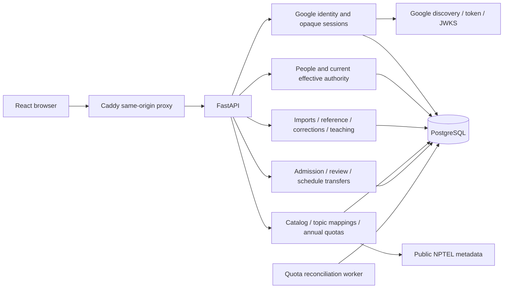

# Architecture — implemented source and academic services

AKUS remains a modular monolith: React/TypeScript through the existing Caddy proxy,
FastAPI/Python 3.13 with sync SQLAlchemy/Psycopg, PostgreSQL and Alembic. No parallel
app, Redis, Kafka or cloud deployment was introduced. See implementation-plan.md.

The Google connection is implemented but live credentials/account-holder UAT were
not available. Automated tests use isolated HTTP responses and generated RSA keys.
Demo mode is explicitly separate and cannot coexist with Google client configuration.
Production settings require complete secure configuration; the local Docker deployment
itself has not passed production hardening.

## Ownership

- identity/provider.py handles only trusted Google discovery/exchange/signatures/claims.
  router.py stores browser-bound one-use state and encrypted PKCE verifier, then closes
  the transaction before provider HTTP. service.py owns stable links, pending accounts,
  sessions and verified provider-email observations. operator.py is a non-web first
  Admin bootstrap/revocation command, not an authentication bypass.
- access.py resolves current person/employment/department/offices and separate Admin
  grant for every request. Demo labels grant nothing. people/service.py locks and
  rechecks live session/link/authority before any source command or receipt replay.
- sources owns bounded import staging and atomic commit, authoritative reference and
  teaching records, versioned corrections and immutable before/after revisions. A
  common advisory lock serializes source/identity writes; lock order is consistent.
  Office corrections supersede immutable issued records. Source changes queue affected
  applications for reconciliation; unratified academic consequences stay pending.
- DB constraints enforce permanent keys, non-overlapping episodes/home memberships,
  scoped offices, global DRC/HoD exclusion and teaching intervals. Triggers prevent
  audit/source/identity history rewriting/deletion. DB superuser remains privileged;
  production least-privilege runtime credentials are a separate operational gate.
- Five distinct dashboard components query real source counts and effective scope.
  API checks are authoritative. React renders loading/error/denied/empty/saved states,
  working forms and history. Academic pages expose current catalog/quota/admission/review services; assessed
  annual/Silver compliance and full reporting still return unavailable.
- Opaque session hashes live server-side. Cookies are HttpOnly/SameSite=Lax for Google,
  Secure with HTTPS; exact Origin and session CSRF protect mutations. Browser storage
  holds only CSRF proof, never provider/session tokens. Structured logs omit query,
  body and credentials; Uvicorn query-bearing access logs are disabled.

Implemented quota submit: resolve eligible source authority, lock/revalidate approved
canonical course-topic mapping and published department/topic/year pool, atomically
reserve and append immutable application snapshot/ledger/audit/outbox. Verified
cross-year reschedule locks both pools; failure retains counted source and flags.
No provider HTTP inside these transactions. Mapping-revision existing-seat treatment
remains pending; actual-exam-year annual credit is distinct from quota charging.

Current boundaries: no private evidence store, provider certificate verification,
assessed annual/Silver credit or backup/restore guarantee.
First-teaching source timelines are provisional, with IO-02/P54 safe pending states.

Academic commands use a shared source-authority gate; source changes use the exclusive
side. Order: command key → offering → application → mapping anchor → sorted pools.
Transfer acceptance locks the offering exclusively and all affected pools deterministically.
Withdrawal uses fresh accepted commencement and rejects any newer conflicting start
date; an exam-only conflict cannot create a withdrawal-ordering failure. App locks
and deferred allocation/ledger/count constraints preserve exactly-once current-pool release.
Manual individual schedule findings bind exact person/offering/current HoD to immutable
source reference/digest/time/reason. Durable notices are in-app, not delivered email.
