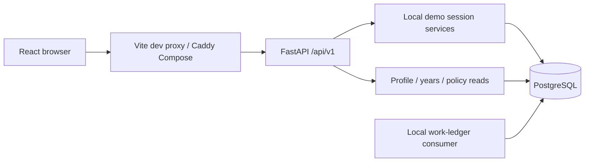

# Architecture — current source workflows and planned academic modules

Phase 2A extends the local-only modular monolith with staff and office source workflows. All subsequent domain modules stay in the same authoritative PostgreSQL transaction boundary. See implementation-plan.md for schema/API/UI order and route-matrix.md for the full target UI.

No live Google/NPTEL/Drive connection exists. Login's Google action is disabled with explanation. Demo identity endpoints require explicit local mode. Production settings fail at startup, even if demo mode is false, until real OIDC/access implementation is provided.

## Ownership and invariants

- `akus/config.py`: validates deployment boundary. No credentials are printed.
- `akus/auth.py`: hashed opaque 256-bit random session token, 8-hour local lifetime, rotation/revocation, CSRF proof. Cookie is HttpOnly/SameSite Strict and non-Secure only for local HTTP. Institutional sessions will require Secure cookies and effective authorization in Phase 2.
- `akus/models.py`: foundation storage only. `demo_identities` is explicitly not the staff/office model. `academic_years` stores date-only July–June boundaries, not inferred quotas. Foreign keys restrict historical deletes.
- `akus/main.py`: typed API contracts, correlation IDs, safe errors, structured JSON request logs without credentials, DB-aware readiness versus independent liveness.
- `akus/worker.py`: row-locked local probe job and audit commit together, unknown kinds dead-lettered, heartbeat read by UI. No remote side effects, lease/retry claims or full delivery pipeline yet.
- `audit_events`: update/delete/truncate blocked by database triggers. PostgreSQL superusers still control database administration; deployment runtime least-privilege roles are later hardening work.
- Web features are separate pages with shared shell, tokens, query cache, generated OpenAPI schema types and a typed HTTP wrapper. No identity/access tokens in localStorage. SessionStorage contains only CSRF proof, not authentication.

Future quota command transaction: resolve eligible employment and current office, validate immutable provider snapshot, lock/revalidate current departmental canonical-course mapping and published topic/year pool, enforce unique active canonical application, append snapshot/allocation/ledger/audit/outbox, then commit. Reschedule locks application and both pools in stable order; failure retains the source. No network call inside either transaction. Historical audit is additive.

All 80 target routes are retained. Foundation homes at role-specific URLs are explicitly not completed academic dashboards. Own profile includes employment/office history; full institutional identity and account linking remain partial; remaining actions are deferred, not fabricated.

## People and access now implemented

`akus/people/models.py`, additive migrations 0002/0003: departments, persons, employment episodes, home assignments, effective offices, Admin grants and source command receipts. `akus/access.py` bridges LOCAL/DEMO sessions to explicit person source records; `DemoIdentity.role` never grants permissions. Reads filter by current authority. Mutations recheck after locks and keep audit + state + receipt in one transaction. No network calls occur in a command transaction.

`people/router.py` validates typed input and mutation origin/CSRF. `people/service.py` owns business transaction boundaries. `people/seed.py` creates conspicuous fictional histories and authority facts independent of demo role labels, including rehire and separated records with no login. Web pages call real routes and invalidate/refetch after confirmation. Query cache keys include effective access so a role/scope change refreshes reads.

Staff search and appointment lists are paginated (maximum 100 rows); detail history currently reads all episodes/offices and latest 100 audit events. Summary lookups are bounded but not yet optimized for large institutional datasets. Person-linked OIDC/session storage, imports, source corrections, teaching assignments and academic dashboards are next Phase 2 work; production remains fail-closed.
