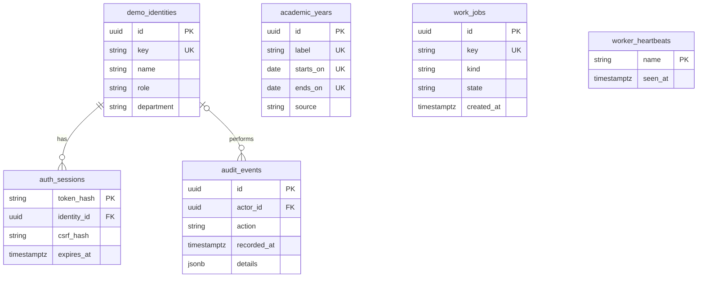
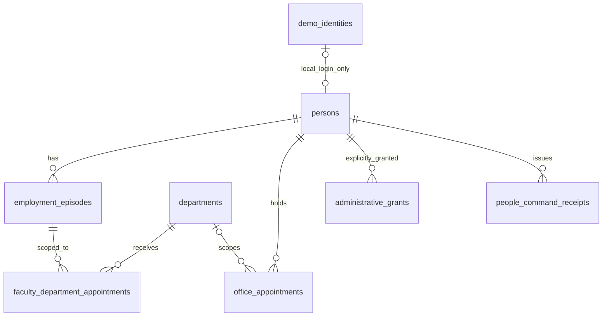

# Implemented schema

Migrations: 0001 foundation, 0002 people/access, 0003 scoped duplicate-office correction (all forward-only). Current head: `0003_office_scope`.

UUID identifiers are stable; deterministic fixture UUIDs support idempotent seeds. Date constraints require July 1 and exactly the following June 30. The original fixture checks remain; additional office and employment exclusion constraints now enforce the source-model invariants. Audit triggers deny UPDATE/DELETE/TRUNCATE. Sessions are deliberately revocable and deleted at logout/rotation. Job dedupe uses unique key; consumption locks rows with SKIP LOCKED. Work audit stores only references.

Future normalized OIDC/teaching/course/topic/quota/application/evidence/compliance models are specified in master section 6 and must be added as tested vertical slices. They are not represented by fake empty CRUD tables here. Domain and outbox retention policies await institutional ratification; no automatic history deletion exists.

Permanent `staff_key` unique; demo identity mapping optional/unique. Employment episodes cannot overlap per person; home assignments cannot overlap per episode. Office group normalizes acting HoD, with global cross-department DRC/HoD exclusion and scoped single officeholder constraint. DRC faculty classification and office/employment containment are service checks; effective resolver also refuses invalid DRC authority. Partial Principal duplicate constraint does not silently declare an institution-wide singleton policy. Principal/departmental overlap is blocked in service and resolver pending institutional authority clarification.

Office issued fields and original expiry are immutable; only shortening current expiry with next version is allowed by the trigger. API additionally requires lock, current Admin authority, reason and audit/receipt. Identity, employment and department correction APIs are not exposed. Direct database administrator access can bypass application-level workflow and is not a production authorization surface.
