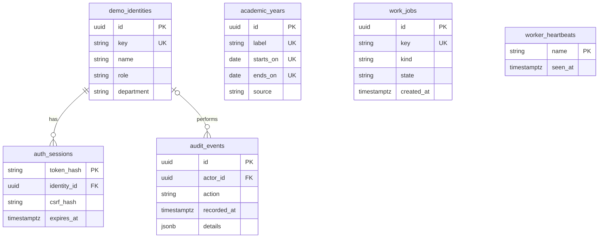
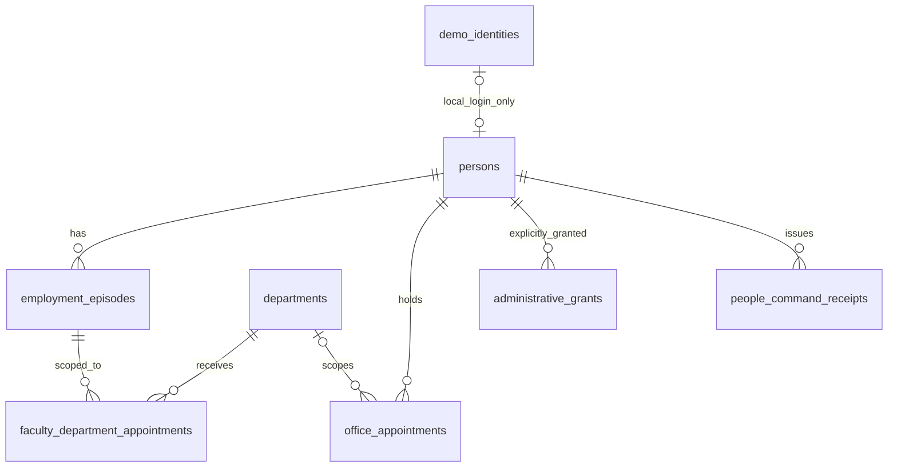
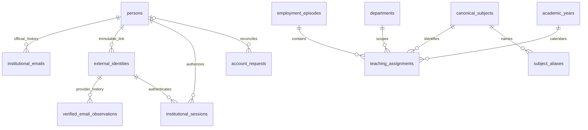
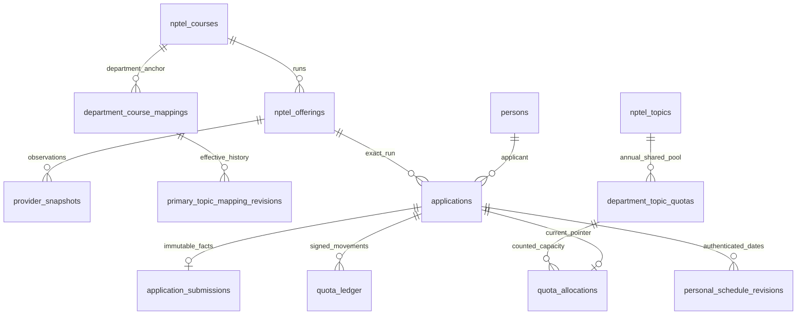

# Implemented schema

Migrations: 0001 foundation, 0002 people/access, 0003 scoped office correction, 0004 institutional identity, 0005 source management, 0006 identity history. All forward-only. Current head: `0010_personal_schedule`.

UUID identifiers are stable; deterministic fixture UUIDs support idempotent seeds. Date constraints require July 1 and exactly the following June 30. The original fixture checks remain; additional office and employment exclusion constraints now enforce the source-model invariants. Audit triggers deny UPDATE/DELETE/TRUNCATE. Sessions are deliberately revocable and deleted at logout/rotation. Job dedupe uses unique key; consumption locks rows with SKIP LOCKED. Work audit stores only references.

Course/topic/quota/application/schedule models were added in 0007–0010 below. Private evidence and compliance models remain future vertical slices under master section 6. Domain and outbox retention policies await institutional ratification; no automatic history deletion exists.

Permanent `staff_key` unique; demo identity mapping optional/unique. Employment episodes cannot overlap per person; home assignments cannot overlap per episode. Office group normalizes acting HoD, with global cross-department DRC/HoD exclusion and scoped single officeholder constraint. DRC faculty classification and office/employment containment are service checks; effective resolver also refuses invalid DRC authority. Partial Principal duplicate constraint does not silently declare an institution-wide singleton policy. Principal/departmental overlap is blocked in service and resolver pending institutional authority clarification.

Office issued fields and original expiry are immutable; shortening effective expiry or marking superseded preserves the original. Replacement office facts are inserted with fresh exclusion checks. Source correction APIs require current Admin, expected version, lock, reason/source and audit/receipt; triggers preserve before/after revisions. Direct database administrator access is not an application authorization surface.

OidcFlow contains hashed state/browser binding, nonce and encrypted short-lived PKCE
verifier; no access/refresh/ID token is durable. External issuer+subject is globally
unique across revoked history; only one current link per person. Sessions are revocable
hash records. Verified email observations are append-only and separate from source
email assignments. Account requests never themselves confer a role.

SourceImport stores bounded normalized rows, errors, provenance/hash and commit state;
source receipts and unique facts make commits retry-safe. SourceRevision records
JSON before/after with actor/source/reason and recorded timestamp; all relevant source
tables have triggers and initial snapshots. Teaching intervals cannot overlap for the
same non-voided episode/subject/department. Void/correction retains revision history.
IO-02 remains pending; no Silver obligation/credit tables are implied by these sources.

Phase 3 additive migrations: 0007 catalog/topic/effective mapping/annual quotas;
0008 immutable admission and allocation ledger; 0009 quota identity/transfer balance;
0010 personal schedule revisions and exact-application evidence binding.

Actual ORM/table definitions are authoritative; mapping revisions exclude overlapping
intervals, with one current revision per department/course. Pool identity is permanent.
Deferred triggers enforce pool occupied = counted allocations = signed ledger sum;
submitted application/allocation states agree. Transfer movement has exactly two
opposite entries in the same department/topic, with matching source/evidence.
Immutable source/submission/ledger/schedule/event/notice facts cannot be rewritten or
truncated. RELEASED allocations cannot reopen; RETAINED seats cannot silently migrate.
Reconciliation cases store current work state while notices/events retain previous facts.
